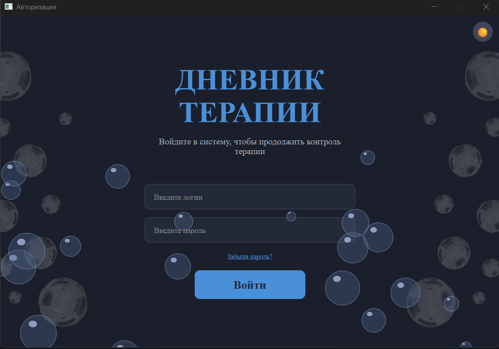
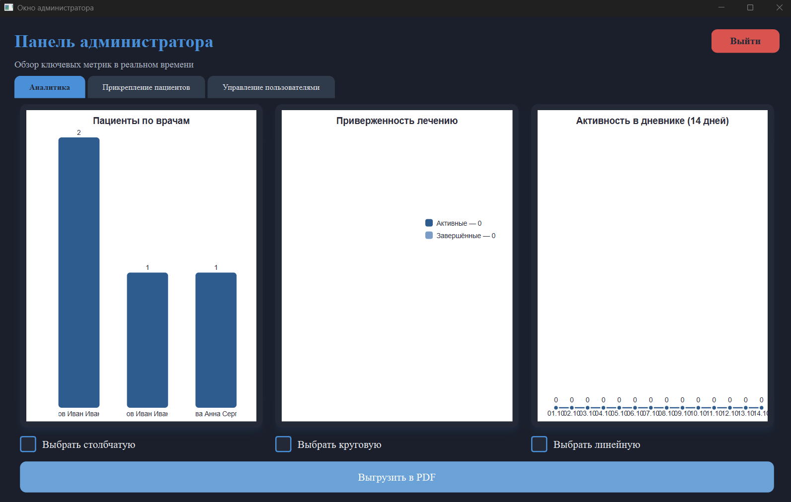
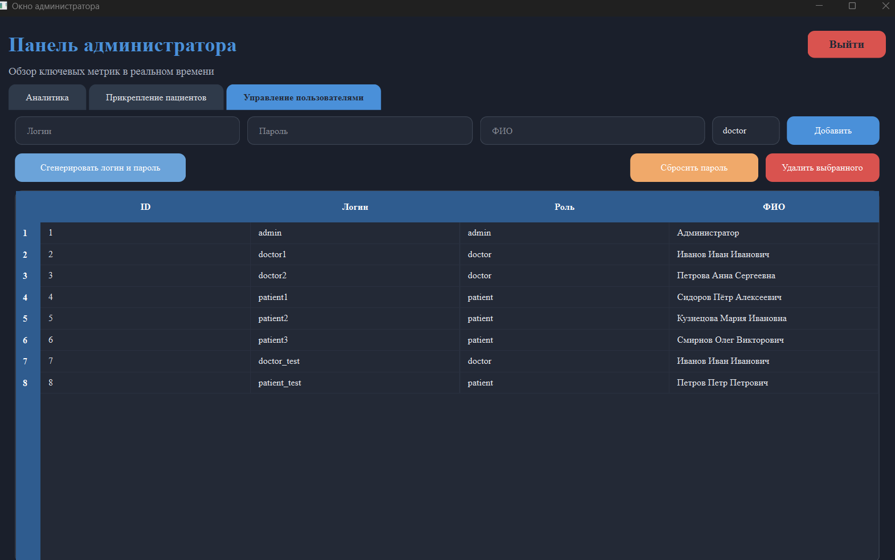
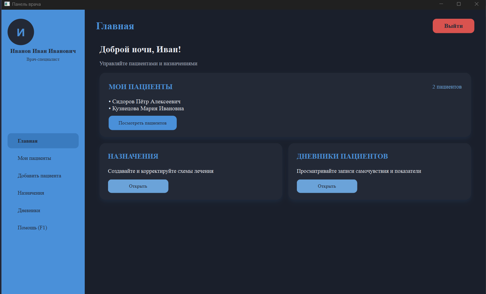
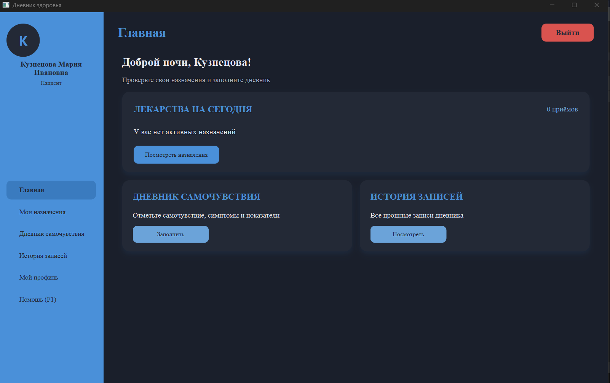

# 🩺 Дневник терапии

[](https://www.python.org/)
[](https://doc.qt.io/qtforpython/)
[](https://www.mysql.com/)
[](https://opensource.org/licenses/MIT)

**Десктопное приложение для ведения дневника самочувствия пациентов, назначений врачей и аналитики для администратора.**

---

## 📖 О проекте

«Дневник терапии» — учебный проект на Python с использованием PySide6 и MySQL. Приложение автоматизирует ведение
медицинских записей: врачи назначают лечение, пациенты отслеживают состояние, администраторы управляют пользователями и
просматривают статистику.

### 🎯 Основные возможности

- **Авторизация** с хешированием паролей (SHA-256) и разграничением прав доступа.
- **Три роли:** администратор, врач, пациент — каждая со своим интерфейсом.
- **Валидация ввода** во всех формах: ФИО, логин, пароль, телефон, полис, дата рождения, показатели здоровья (давление,
  пульс, сахар, температура, рост, вес).
- **Дневник самочувствия:** симптомы, показатели, триггеры, заметки.
- **Назначения:** выбор препарата из справочника, дозировка, кратность, период приёма.
- **Расписание приёма:** врач может указать конкретные часы приёма (8:00, 14:00, 20:00).
- **Напоминания о приёме лекарств:** внутри приложения пациенту всплывает уведомление в назначенное время.
- **Справочник МКБ-10:** постановка диагноза с выбором болезни из классификатора.
- **Аналитика администратора:** графики и экспорт в PDF.
- **Тёмная тема** и **горячие клавиши** (F1 — помощь, Ctrl+Q — выход).

---

## 🛠 Технологии

| Технология               | Назначение                  |
|--------------------------|-----------------------------|
| Python 3.10+             | Язык программирования       |
| PySide6 (Qt for Python)  | Графический интерфейс       |
| MySQL 8.0+               | База данных                 |
| mysql-connector-python   | Драйвер подключения к MySQL |
| hashlib (SHA-256)        | Хеширование паролей         |
| Qt Designer              | Создание UI-форм            |
| PEP 8 (black, flake8)    | Единый стиль кода           |
---

## 📸 Скриншоты

### Авторизация



### Окно администратора — статистика



### Окно администратора — управление пользователями



### Окно врача



### Окно пациента



---

## 🚀 Установка и запуск

### 1. Клонировать репозиторий

```bash
git clone https://github.com/lllizaveta-kr/diary-therapy.git
cd diary-therapy
```

### 2. Создать виртуальное окружение и установить зависимости

```bash
python -m venv .venv
.venv\Scripts\activate
pip install -r requirements.txt
```

### 3. Настроить подключение к БД

Скопируйте `config.example.py` в `config.py` и укажите свой пароль от MySQL.

### 4. Создать базу данных

Выполните SQL-скрипт из папки `sql/` в MySQL Workbench.

### 5. Запустить приложение

```bash
python main.py
```

---

## 📂 Структура проекта

```
diary-therapy/
├── images/              # Изображения (фоны, скриншоты)
├── sql/                 # SQL-скрипт для создания БД
├── tests/               # Тестовые скрипты
├── ui/                  # Файлы Qt Designer (.ui)
├── ui_py/               # Сгенерированные Python-файлы интерфейсов
├── windows/             # Логика окон приложения
│   ├── admin_window.py  # Окно администратора
│   ├── doctor_window.py # Окно врача
│   ├── patient_window.py# Окно пациента
│   ├── login_window.py  # Окно авторизации
│   └── msgbox.py        # Всплывающие сообщения
├── config.example.py    # Пример конфигурации БД
├── config.py            # Конфигурация БД (в .gitignore)
├── db.py                # Функции работы с базой данных
├── main.py              # Точка входа
├── path.py              # Пути к ресурсам
├── theme.py             # Управление темами
├── validators.py        # Валидация пользовательского ввода
└── README.md
```

---

## 🔮 В планах

- Email-уведомления пациентам о времени приёма лекарств (через SMTP).
- Telegram-уведомления через бота.
- Полноценное покрытие unit-тестами.

---

## 📄 Лицензия

Проект распространяется под лицензией MIT. Подробности в файле [LICENSE](LICENSE).

---

## 👩‍💻 Автор

**Елизавета Кравцова**  
GitHub: [@lllizaveta-kr](https://github.com/lllizaveta-kr)